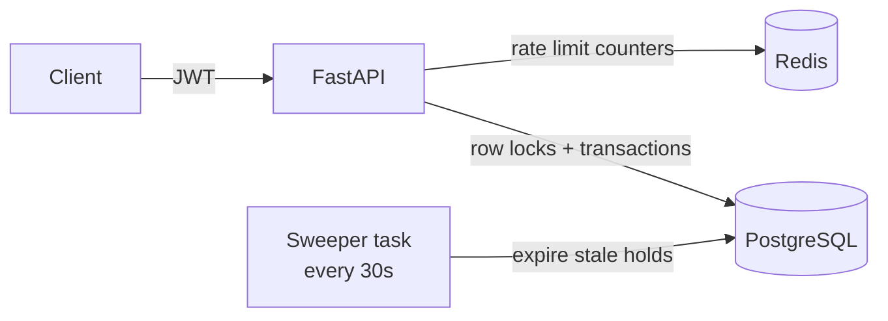
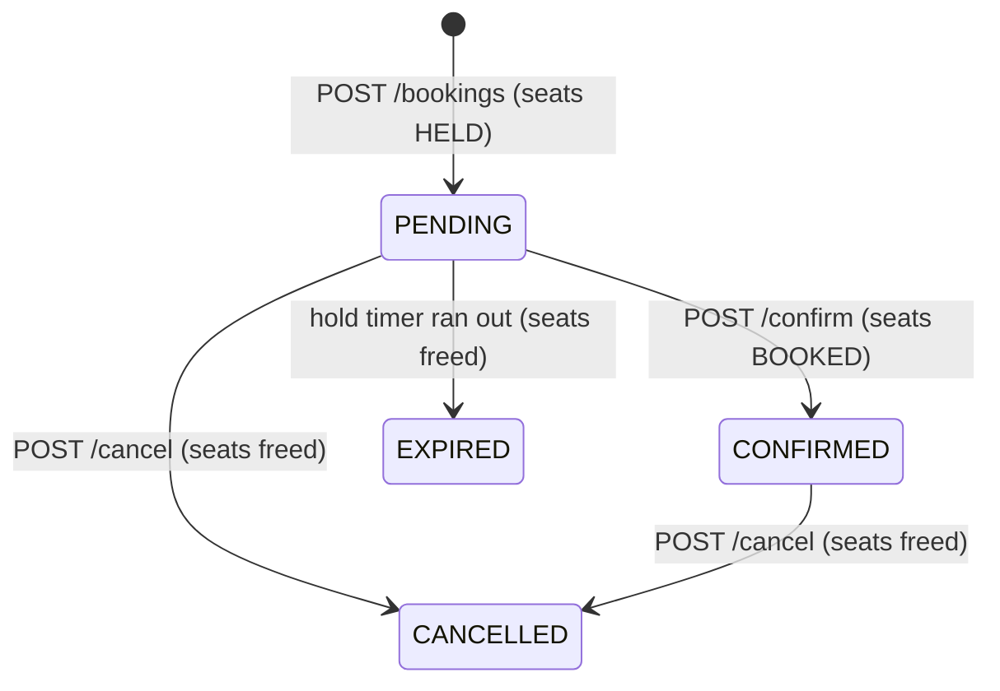

# SeatLock — a seat booking API that never double-books


> The CI workflow file is kept in `scripts/ci.yml`; `scripts/setup.sh` copies it into `.github/workflows/`.

A backend for booking seats at concerts, movies or matches, in the style of BookMyShow.
The interesting part is not the CRUD. It is what happens when **hundreds of people try
to grab the same seat at the same second**, when a user **double-clicks "Pay"**, or when
someone **holds seats and never pays**.

**Stack:** Python · FastAPI · PostgreSQL · SQLAlchemy 2.0 · Redis · Docker · pytest · GitHub Actions

---

## What it does

| Feature | How |
|---|---|
| No double booking under heavy concurrency | `SELECT … FOR UPDATE` row locks in PostgreSQL |
| No deadlocks when requests overlap | Seats are always locked in ascending id order |
| Seats are held for 5 minutes while you pay | `hold_expires_at` column; expired holds count as free immediately |
| Abandoned holds are cleaned up | Background sweeper using `FOR UPDATE SKIP LOCKED` |
| Retrying never creates a second booking or charge | `Idempotency-Key` header + unique constraint |
| All-or-nothing multi-seat booking | One transaction: either every seat is held or none |
| Bots can't spam bookings | Per-user rate limit in Redis (fails open if Redis is down) |
| Auth | JWT bearer tokens, PBKDF2-SHA256 password hashing, admin role |
| Money is exact | `NUMERIC(10,2)` / `Decimal`, never float |

## Architecture





### How a booking stays safe

```
User A ──┐                          ┌─ locks seat 7 ─ checks: free ─ holds it ─ COMMIT ─┐
         ├─ POST /bookings seat 7 ──┤                                                    │
User B ──┘                          └─ waits for the lock ................................┴─ checks: HELD → 409
```

1. **Lock** the requested seats with `SELECT … FOR UPDATE ORDER BY id`. A second request
   for the same seat waits until the first one commits, then sees the new state.
2. **Check** the idempotency key (a retry may have committed while we waited).
3. **Check** every seat is free. If any is taken → roll back → `409 Conflict`.
4. **Write** the booking and mark the seats `HELD` in the same transaction → commit.

All of this lives in [`app/services/booking_service.py`](app/services/booking_service.py).

## The web app

Open **http://localhost:8000** for the booking website (the API docs stay at `/docs`).

| Page | What you can do |
|---|---|
| Shows | See what's on sale, prices and how many seats are left |
| Seat map | Tap seats on a live map (it refreshes every 4 s, so seats other people are holding appear hatched), then hold them |
| Checkout | 5-minute countdown, demo payment, an option to simulate a declined card, or release the seats |
| My tickets | Confirmed, pending, cancelled and expired bookings; cancel a ticket |
| Add a show | Organisers (admin accounts) create a show with standard and premium rows |

It is plain HTML, CSS and JavaScript in `app/static/`, served by FastAPI, so there is no build step.
Every action goes through the same REST API, including the Idempotency-Key on holds and payments.

**Let friends on the same Wi-Fi book:** run **SeatLock (share on Wi-Fi)** from Run and Debug,
allow incoming connections if macOS asks, then share `http://<your-mac's-IP>:8000`
(find the IP in System Settings → Wi-Fi → Details).

## Run it in VS Code (macOS)

The project opens in **its own VS Code window**, separate from your other projects:
double-click `seatlock.code-workspace`, or in VS Code use **File → Open Workspace from File…**.
Click **Install** when VS Code suggests the recommended extensions.

You need **Python 3.10+** (`brew install python@3.12`) and **one** way to run PostgreSQL:
[Docker Desktop](https://www.docker.com/products/docker-desktop/) *(easiest)*, or Homebrew (step 2b).

1. **Set up** — `Cmd+Shift+P` → *Tasks: Run Task* → **1. Set up project**
   (creates `.venv`, installs packages, creates `.env`). If VS Code asks for an interpreter,
   choose `./.venv/bin/python`.
2. **Start the database**
   - a. With Docker: *Tasks: Run Task* → **2. Start database (Docker)**
   - b. With [Postgres.app](https://postgresapp.com) (no Docker or Homebrew needed): open it, click
     **Initialize**, then *Tasks: Run Task* → **2b. Create database (Postgres.app, no Docker)**.
     Set `REDIS_URL=` (empty) in `.env`.
   - c. With Homebrew instead (Redis is optional, the app works without it):
     ```bash
     brew install postgresql@16 && brew services start postgresql@16
     psql postgres -c "CREATE ROLE booking LOGIN PASSWORD 'booking' CREATEDB;"
     createdb -O booking booking && createdb -O booking booking_test
     ```
     and set `REDIS_URL=` (empty) in `.env` if you don't run Redis.
3. **Seed** — Run and Debug panel (`Cmd+Shift+D`) → **Seed database** → ▶
4. **Run** — pick **SeatLock API** → ▶ (or `F5`). Breakpoints work: try one in
   `app/services/booking_service.py`, then book a seat.
5. **Use it** — open http://localhost:8000/docs, or open `requests.http` and click
   **Send Request** above each block.
6. **Test** — Testing panel (flask icon) → ▶ Run All, or *Tasks: Run Task* → **Run tests**.

Admin login after seeding: `admin@seatlock.dev` / `admin12345`.

## Run it with Docker only

**With Docker (easiest):**

```bash
docker compose up --build
docker compose exec api python -m scripts.seed   # creates admin + a sample event
```

Open **http://localhost:8000/docs** for interactive Swagger docs.
Log in at `/auth/login`, copy the token, click **Authorize**.

**Without Docker:** start PostgreSQL and Redis yourself, then

```bash
python -m venv .venv && source .venv/bin/activate   # Windows: .venv\Scripts\activate
pip install -r requirements-dev.txt
cp .env.example .env    # edit DATABASE_URL, then export the variables
uvicorn app.main:app --reload
```

## Try it with curl

```bash
# sign up + log in
curl -X POST localhost:8000/auth/register -H 'Content-Type: application/json' \
     -d '{"email":"riya@example.com","password":"password123"}'
TOKEN=$(curl -s -X POST localhost:8000/auth/login -H 'Content-Type: application/json' \
     -d '{"email":"riya@example.com","password":"password123"}' | python -c 'import sys,json;print(json.load(sys.stdin)["access_token"])')

# see seats, hold two, pay
curl localhost:8000/events/1/seats
curl -X POST localhost:8000/bookings -H "Authorization: Bearer $TOKEN" \
     -H "Idempotency-Key: $(uuidgen)" -H 'Content-Type: application/json' \
     -d '{"event_id":1,"seat_ids":[1,2]}'
curl -X POST localhost:8000/bookings/1/confirm -H "Authorization: Bearer $TOKEN" \
     -H "Idempotency-Key: $(uuidgen)" -H 'Content-Type: application/json' \
     -d '{"payment_token":"tok_success"}'
```

## API

| Method | Path | Who | Description |
|---|---|---|---|
| POST | `/auth/register` | anyone | Create an account |
| POST | `/auth/login` | anyone | Get a JWT |
| GET | `/auth/me` | user | Current user |
| POST | `/events` | admin | Create an event and its seat grid |
| GET | `/events` | anyone | List events with available seat counts |
| GET | `/events/{id}/seats` | anyone | Seat map |
| POST | `/bookings` | user | Hold seats (needs `Idempotency-Key`) |
| POST | `/bookings/{id}/confirm` | owner | Pay (needs `Idempotency-Key`; `tok_fail` simulates a declined card) |
| POST | `/bookings/{id}/cancel` | owner | Cancel and free the seats |
| GET | `/bookings` | user | My bookings |
| GET | `/health` | anyone | Liveness + DB check |
| GET | `/` | anyone | The booking website |

Status codes used on purpose: `201` new hold, `200` replayed request, `402` payment
declined, `404` not found *or not yours* (so ids can't be probed), `409` seat taken,
`410` hold expired, `422` idempotency key reused for a different request, `429` rate limited.

## Tests

```bash
docker compose up -d db          # tests need real PostgreSQL (SQLite ignores FOR UPDATE)
pytest -v
```

Highlights:

- **`test_last_seat_race_has_exactly_one_winner`** — 40 threads with separate DB
  connections released at the same instant by a barrier, all wanting the last seat.
  Exactly one wins.
- **`test_overlapping_multi_seat_requests_never_double_book_or_deadlock`** — 40 users
  ask for random overlapping seat pairs *in random order*. No deadlocks, no seat in two bookings.
- **`test_double_click_on_pay_charges_once`** — 10 simultaneous confirms with one key → one payment.
- Expiry, late payment after someone else took the seat, declined card, cancel,
  rate limiting, users can't see each other's bookings.

CI runs the full suite against PostgreSQL 16 on every push.

## Load test: 500 users, 1 seat

```bash
docker compose up -d && docker compose exec api python -m scripts.seed
python -m scripts.load_test --users 500
```

Measured on an Apple Silicon MacBook Pro (one uvicorn process started from the VS Code debugger, PostgreSQL 18 via Postgres.app):

| Metric | Result |
|---|---|
| Concurrent requests | 500 |
| `201 Created` | **1** |
| `409 Conflict` | **499** |
| p50 / p95 latency | 973 ms / 1,806 ms |
| Double bookings | **0** |
| Wall time for all 500 | 2.0 s |

Why is latency around a second? All 500 requests want the *same row*, so PostgreSQL deliberately lines
them up one at a time: that queue is the correctness guarantee. Requests for different seats don't wait
on each other. Running without the debugger and with more uvicorn workers would cut the numbers further.

## Design decisions (a.k.a. interview answers)

**Why pessimistic locking (`FOR UPDATE`) and not optimistic locking (version column)?**
Popular seats are *high contention*: hundreds of people want the same few rows. With
optimistic locking most of them would read, fail the version check and retry, which wastes
work and hammers the DB. With a lock they simply queue for a few milliseconds. Optimistic
locking is the better choice when conflicts are rare (e.g. editing a profile).

**Why sort the seat ids before locking?**
If A locks seat 5 then wants 6, while B locks 6 then wants 5, they wait on each other forever
(Postgres detects it and kills one). If everyone locks in the same order, that cycle can't form.

**Why keep holds in PostgreSQL instead of Redis keys with a TTL?**
The hold and the booking must change together, atomically. Splitting them across two
systems means a crash between the two writes leaves them disagreeing. One source of truth
is simpler and correct. Redis is used for what it's great at: fast, shared counters for
rate limiting.

**What if the sweeper is slow or down?**
Nothing breaks. Any hold past `hold_expires_at` is treated as free the moment someone asks
for that seat. The sweeper only tidies up status columns. It uses `SKIP LOCKED` so it never
blocks a user who is confirming at that moment, and several sweepers could run in parallel.

**What if the hold expires while the user is paying?**
Confirm re-checks the expiry *and* that the booking still owns every seat. If another user
already took a seat, the payment is refused with `410` instead of confirming a broken booking.

**How do idempotency keys work?**
The client sends a unique key per action. `(user_id, hold_key)` is a unique constraint, so the
database itself guarantees one booking per key, even if two retries arrive at once. For
payments, the key is stored with the confirmed booking; a retry gets the original result back.

**Why return 404 for someone else's booking instead of 403?**
403 would confirm the booking exists. 404 reveals nothing.

### What would you change in production?

- **Don't call the payment provider while holding row locks.** Create a payment intent first,
  confirm the booking from the provider's webhook, and keep the locked section short.
- **Alembic migrations** instead of `create_all`.
- **Run several API instances** behind a load balancer (already safe: all coordination is in
  Postgres and Redis, nothing is kept in process memory except the optional fallback limiter).
- **Read replicas / caching** for the seat map, which is read far more often than written.
- **Outbox pattern** to send confirmation emails reliably after commit.
- **Observability:** structured logs, request ids, Prometheus metrics for lock wait time.

## Project layout

```
app/
  main.py                 FastAPI app, error mapping, background sweeper
  services/booking_service.py   ← all the concurrency logic
  routers/                auth, events, bookings endpoints
  models.py  schemas.py   DB tables and request/response shapes
  security.py deps.py     passwords, JWT, auth & rate-limit dependencies
  rate_limit.py           Redis fixed-window limiter
tests/                    API tests + concurrency tests (real PostgreSQL)
scripts/seed.py           admin user + sample event
scripts/load_test.py      500-user race
```

## Resume bullets

- Built **SeatLock**, a concurrency-safe seat booking REST API (FastAPI, PostgreSQL, Redis, Docker)
  that guarantees zero double-bookings using row-level locking with deterministic lock ordering.
- Implemented idempotent hold and payment endpoints (Idempotency-Key + DB unique constraints),
  expiring seat holds with a non-blocking `SKIP LOCKED` sweeper, JWT auth and Redis rate limiting.
- Verified correctness with multi-threaded race tests and a 500-concurrent-user load test
  (500 requests: exactly 1 booking, 499 clean rejections, 0 double bookings); CI runs the suite against PostgreSQL on every push.
